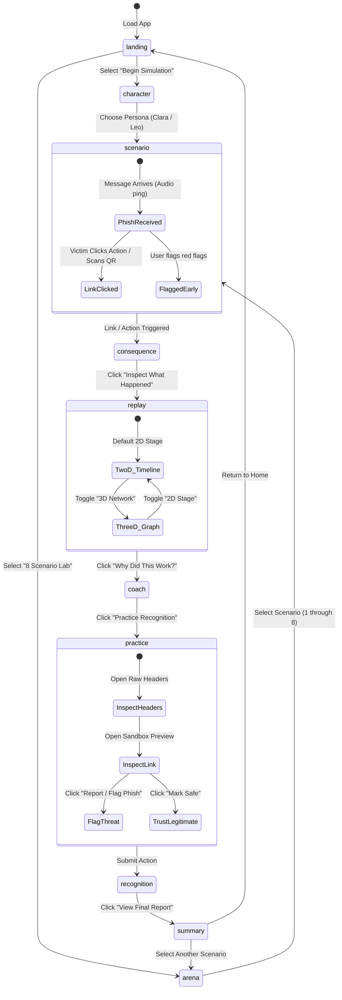

# Second Signal — Technical Design Document (TDD)

> **Document Version:** 2.4.0  
> **System Architecture:** Full-Stack Client-Server with Vite SPA & Node.js Express Proxy  
> **Target Platform:** Modern Web (Desktop, Tablet, Mobile 320px+)  
> **Primary AI Integration:** Google GenAI SDK (`@google/genai`) / Gemini 2.5 Flash  

---

## 1. Executive Summary & System Goals

**Second Signal** is an interactive, browser-based cybersecurity training platform designed around **experiential immersion** rather than static compliance quizzes. The core thesis of the platform is that social engineering attacks exploit human cognitive reflexes—urgency, deference to authority, financial fear, curiosity, and fatigue—rather than a lack of policy knowledge.

### 1.1 Core Engineering Goals
1. **High-Fidelity Hardware Simulation**: Deliver pixel-perfect, responsive simulations of personal mobile smartphones (iOS/Android aesthetic) and enterprise desktop workstations (browser tabs, email client, raw RFC-5322 header inspector).
2. **Dual-Device Synchronization**: Support scenarios where an attack spans both workstation and phone simultaneously (e.g., Corporate SSO phishing triggering an unauthorized mobile MFA push).
3. **Interactive 2D & 3D Attack Visualization**: Enable learners to dissect the chronological attack chain in both a multi-chapter 2D forensic timeline and a spatial 3D Three.js topological node network.
4. **Adaptive Behavioral AI Loop**: Leverage Google Gemini (`gemini-2.5-flash`) via a server-side proxy to generate personalized follow-up phishing vectors matching the user's diagnosed vulnerabilities, backed by a resilient offline fallback circuit-breaker.
5. **Mobile-First Responsiveness**: Ensure 100% of the simulation environments, controls, and visualizers render without horizontal scroll down to 320px mobile viewports.

---

## 2. High-Level System Architecture

Second Signal is structured as a full-stack Node.js application where Express serves both as an API reverse-proxy for Gemini AI calls and as the development/production host for the React 19 single-page application.

```
+-----------------------------------------------------------------------------------+
|                                  CLIENT LAYER (React 19 + TypeScript)              |
|                                                                                   |
|  +--------------------+  +--------------------+  +-----------------------------+  |
|  |   App Router /     |  |   Zustand Store    |  |       Hardware Sims         |  |
|  |  Scenario Control  |  | (sessionStore.ts)  |  |  +------------+ +---------+ |  |
|  +--------------------+  +--------------------+  |  | Phone Sim  | | Laptop  | |  |
|            |                       |             |  +------------+ +---------+ |  |
|            v                       v             +-----------------------------+  |
|  +--------------------+  +--------------------+                 |                 |
|  | 3D Three.js Engine |  | Web Audio Engine & |                 v                 |
|  | (Attack Visualizer)|  | Web Speech Coach   |  +-----------------------------+  |
|  +--------------------+  +--------------------+  |  Cognitive Radar & Forensic |  |
|                                                  |         Diagnostics         |  |
|                                                  +-----------------------------+  |
+-----------------------------------------------------------------+-----------------+
                                                                  |
                                                  HTTP / JSON     | REST Endpoints
                                                                  v
+-----------------------------------------------------------------------------------+
|                         SERVER LAYER (server.ts - Express 4.x)                    |
|                                                                                   |
|  +-------------------------------------+   +------------------------------------+ |
|  |       API Route Handlers            |   |         Static / Vite Handler      | |
|  |  - POST /api/scenario/generate      |   |  - Dev: vite.middlewares (SPA)    | |
|  |  - POST /api/coach/feedback         |   |  - Prod: express.static('dist')    | |
|  |  - GET  /api/health                 |   |                                    | |
|  +-------------------------------------+   +------------------------------------+ |
|                    |                                                              |
|                    v                                                              |
|  +-------------------------------------+                                          |
|  | Google GenAI SDK (@google/genai)    |                                          |
|  | Model: gemini-2.5-flash             |                                          |
|  +-------------------------------------+                                          |
+--------------------+--------------------------------------------------------------+
                     |
                     v External TLS (REST)
+-----------------------------------------------------------------------------------+
|                          GOOGLE AI STUDIOS / GEMINI API                           |
+-----------------------------------------------------------------------------------+
```

---

## 3. End-to-End Simulation State Machine

The entire educational journey follows a strict Finite State Machine (FSM) managed centrally by Zustand:



### Stage Transitions Matrix

| Current Stage | Trigger Action | Next Stage | State Updates |
|---|---|---|---|
| `landing` | Click "Begin Simulation" | `character` | Resets active scenario to default |
| `landing` | Click "8 Scenario Lab" | `arena` | Preserves overall completion badges |
| `character` | Click Persona Card | `scenario` | Sets persona ID, weakness focus |
| `arena` | Click Scenario Card | `scenario` | Loads scenario ID, updates device layout |
| `scenario` | Click Phish Link / Scan QR | `consequence` | Triggers consequence animation, audio buzzer |
| `consequence` | Click "Analyze Attack" | `replay` | Initializes replay scrubber at step 0 |
| `replay` | Click "Behavioral Analysis" | `coach` | Computes cognitive vulnerability score |
| `coach` | Click "Practice" | `practice` | Mounts simulated workstation email client |
| `practice` | Click Flag or Mark Safe | `recognition` | Evaluates header & sandbox link usage |
| `recognition` | Click "View Summary" | `summary` | Computes composite cognitive radar chart |

---

## 4. Hardware Simulation Subsystems

### 4.1 Simulated Mobile Phone (`SimulatedPhone.tsx`)
- **Visual Chassis**: Responsive container styled with dynamic notch, status bar (Time, 5G, Wi-Fi, 100% battery), and iOS-style home bar indicator.
- **Dynamic App Switcher**: Supports seamless switching between:
  - `Messages`: Interactive SMS threads with incoming typing indicators, time stamps, and clickable action cards.
  - `Bank`: Realistic mobile banking interface with account balance, transaction ledger, and fake verification overlays.
  - `Pay / UPI`: UPI interface with collect requests, QR scanner simulator, and secure PIN input dialogue.
  - `Photos`: Personal gallery to contextualize the victim persona.
  - `Lockscreen Notifications`: Ambient push notification banners appearing dynamically with sound effects.
- **Small-Viewport Safeguards**: Dynamic aspect-ratio handling ensures the phone scales gracefully down to 320px width without cutoffs.

### 4.2 Simulated Desktop Workstation (`SimulatedLaptop.tsx`)
- **OS Window Frame**: Styled with macOS/Linux dark title bar (close/minimize/maximize buttons), active window header, and browser address bar.
- **Enterprise Email Client**:
  - Folder tree: Inbox (with unread badge counter), Starred, Sent, Trash.
  - Email header bar: Sender name, email address, SPF/DKIM verification chip, date, and security warning flags.
- **Raw RFC-5322 Email Header Inspector**:
  - Expandable drawer rendering realistic internet mail headers:
    ```
    Received: from mail-relay.inbound-security.net (198.51.100.42)
    Authentication-Results: spf=softfail (sender IP does not match SPF record);
                            dkim=none; dmarc=fail action=none;
    From: "IT Support Desk" <admin@apexcorp-security-verify.net>
    Return-Path: <bounce@unverified-relay-host.ru>
    ```
- **Isolated Sandbox Link Tester**:
  - Safe in-simulation modal allowing the user to paste or test suspicious URLs.
  - Resolves target IP, flags deceptive redirect parameters (`?redirect_to=`), and identifies punycode/lookalike characters.

### 4.3 Dual-Device Orchestration (`Scenario2CorporateSSO`, `Scenario8RefundHelpline`)
- For multi-channel vectors, the simulation mounts the desktop workstation beside an active docked smartphone widget (`DockedPhoneWidget.tsx`).
- **Mobile Viewport Switcher**: On screens $< 1024\text{px}$, the UI provides a sticky segmented control (`💻 Workstation` vs. `📱 Authenticator / Phone`) allowing instantaneous toggling between the workstation email and the mobile phone MFA prompt without layout collapse.

---

## 5. Attack Visualization & 3D Replay Engine

### 5.1 3D Topological Attack Graph (`ThreeAttackReplay.tsx`)
Built using pure **Three.js** without heavy external wrappers, ensuring zero memory leaks and maximum 60fps performance across devices.

```
       [ 01: Victim Device ]
           (Phone / Laptop)
             │          ▲
      (Payload)     (Stolen Data)
             │          │
             ▼          │
  [ 02: Adversary Interceptor ]
       (Fake Domain / Proxy)
             │
      (Harvested Creds)
             ▼
  [ 03: Command & Control (C2) ] ──(Lateral Action)──► [ 04: Corporate / Bank ]
       (Rogue Server)                                    (Compromised Target)
```

#### Node Graph Specifications
- **Node 1 (Victim)**: Position `[-3, 0, 0]`. Color: Cyan (`#06b6d4`). Geometry: Rounded Box / Cylinder representing the user's hardware.
- **Node 2 (Interceptor)**: Position `[-1, 1.5, 0]`. Color: Amber (`#f59e0b`). Geometry: Octahedron representing proxy harvesting.
- **Node 3 (Adversary C2)**: Position `[1, -1.5, 0]`. Color: Crimson (`#ef4444`). Geometry: Icosahedron with wireframe rotation representing hacker server.
- **Node 4 (Target Service)**: Position `[3, 0, 0]`. Color: Emerald (`#10b981`). Geometry: Cylinder representing the legitimate bank/cloud infrastructure.

#### Particle & Laser Packet Streams
- Dynamically rendered line segments with additive blending (`THREE.AdditiveBlending`).
- Packet pulses animate along bezier curves between nodes corresponding to the current step in the attack timeline.
- Step-scrubber controls allow bidirectional scrubbing:
  - Step 1: Reconnaissance & Target Identification
  - Step 2: Message Delivery & Deceptive Hook
  - Step 3: Victim Interaction & Credential Capture
  - Step 4: Token Exfiltration & Account Drain

### 5.2 2D Multi-Perspective Forensic Timeline (`AttackReplay2D.tsx`)
- Provides a side-by-side comparative viewport:
  - **Victim Perspective**: What the screen showed (e.g., standard login form with authentic logo).
  - **Adversary Perspective**: Real-time terminal output, captured keystrokes, harvested cookies, and automated API requests to the target bank.
- Chapter scrubber allows jumping directly to:
  - Chapter 1: Reconnaissance
  - Chapter 2: Delivery Vector
  - Chapter 3: Payload Trigger
  - Chapter 4: Exfiltration & Impact

---

## 6. AI Architecture & Resilient Pipeline

### 6.1 Server-Side Proxy Design
In compliance with strict security requirements:
- The Google GenAI client is instantiated **exclusively server-side** in `server.ts`.
- Zero API keys are ever bundled into client assets or exposed in client requests.
- Client requests communicate via clean JSON REST endpoints (`/api/scenario/generate`, `/api/coach/feedback`).

```
[ Client UI ] ──(POST /api/scenario/generate)──► [ Express server.ts ]
                                                         │
                                        Check process.env.GEMINI_API_KEY
                                          ├── Present: Call Gemini 2.5 Flash
                                          │     └── Validate output with Zod
                                          │           ├── Valid: Return generated JSON
                                          │           └── Invalid: Return curated fallback
                                          └── Missing: Return curated fallback
```

### 6.2 Structured Outputs & Zod Schema Validation
Gemini is invoked using `responseMimeType: 'application/json'` and a JSON schema enforcing structured fields:
- Scenario metadata: `id`, `title`, `channel`, `attackType`, `difficulty`
- Message contents: `sender`, `senderHandle`, `subject`, `body`, `ctaLabel`, `fakeUrl`
- Threat indicators: `weaknessTag`, `redFlags`, `attackerTimeline`
- Guidance: `coachExplanation`, `safeAlternatives`

Before returning data to the client, the backend validates the response against `ScenarioSchema` using Zod:

```typescript
const parsed = JSON.parse(response.text || '{}');
const validated = ScenarioSchema.safeParse(parsed);
if (validated.success) {
  return res.json({ scenario: validated.data, source: 'gemini' });
} else {
  return res.json({ scenario: fallbackScenario, source: 'fallback_validation_recovery' });
}
```

---

## 7. Cognitive Behavioral Heuristics & Scoring Engine

Second Signal models five distinct cognitive vulnerability dimensions:

$$\text{Threat Index} = \sum_{i=1}^{5} (w_i \cdot V_i) - \text{Verification Bonus}$$

### Cognitive Dimensions
1. **Urgency Vulnerability ($V_{\text{urgency}}$)**: Reaction speed under artificial time constraints (e.g., "within 24 hours" or "before 6 PM").
2. **Authority Compliance ($V_{\text{authority}}$)**: Tendency to comply with corporate leadership, IT security mandates, or official badge iconography without out-of-band verification.
3. **Financial Anxiety ($V_{\text{financial}}$)**: Sensitivity to account suspensions, missed payroll, or unexpected refund/cashback claims.
4. **Curiosity & Friction Aversion ($V_{\text{curiosity}}$)**: Propensity to click links to resolve minor ambiguity or avoid shipping delays.
5. **Verification Discipline ($V_{\text{verification}}$)**: Habit of inspecting raw headers, examining link domains in sandboxes, and flagging threats rather than interacting.

The final summary stage computes a dynamic **Cognitive Radar Chart** visualizing the user's defense profile with actionable behavioral takeaways.

---

## 8. Security & Containment Architecture

Because Second Signal simulates realistic phishing attacks, strict security guardrails are baked into the architecture:

1. **Inert Domains Only**: All simulation URLs use non-resolvable fictional top-level domains (e.g., `.invalid`, `.test`, `.local`) or clearly inert synthetic domains (e.g., `hdfc-kyc-update.me`, `apexcorp-internal-auth.net`).
2. **Zero Inbound/Outbound Credential Storage**: Password inputs and OTP fields do not transmit credentials to any external service. Inputs are evaluated purely in local React state.
3. **Sandbox Link Previews**: The simulated link previewer performs synthetic heuristic parsing without executing JavaScript or loading remote iframes.
4. **No Telemetry Leakage**: Client actions are stored strictly in browser memory (`sessionStorage`/Zustand); no third-party tracking scripts or surveillance cookies are injected.

---

## 9. Responsive Layout & Viewport Engineering

To guarantee a frictionless experience on smartphones:
- **Zero Horizontal Overflow**: `html, body` configured with `overflow-x: hidden` and `-webkit-text-size-adjust: 100%`.
- **Touch Manipulation**: `touch-action: manipulation` applied globally to eliminate mobile 300ms tap delays.
- **Dynamic Scale Matrix**: Workstation and Phone frames use responsive CSS transforms and flex-scaling so the device chassis fits comfortably on 320px, 375px, 414px, 768px, and 1440px displays alike.
- **Accessible Touch Targets**: All action buttons, dropdown selectors, and zoom controls maintain $\ge 44\text{px}$ minimum touch bounding boxes.
